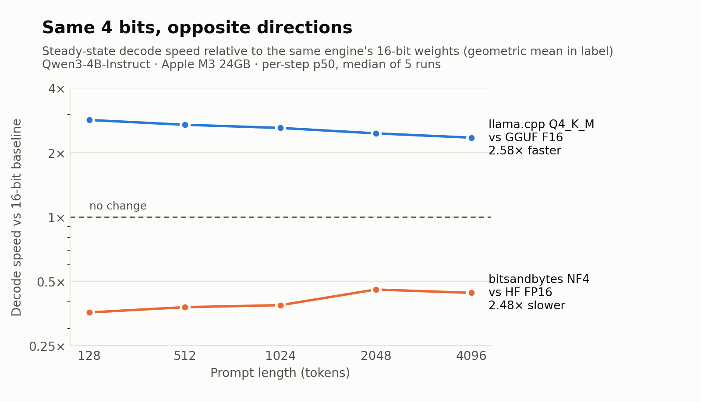
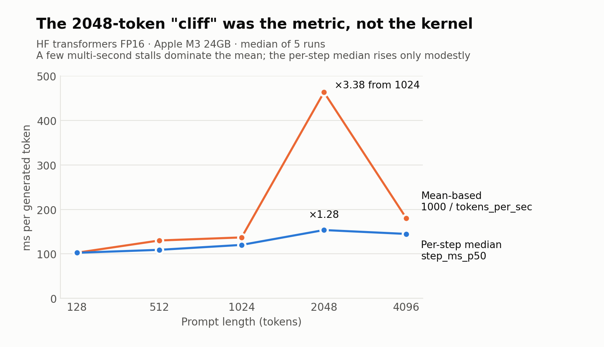

# On-Device LLM Quantization Benchmark — Qwen3-4B on Apple Silicon

[한국어](README.ko.md)

A controlled 2×2 comparison of **inference engine × weight precision** for `Qwen/Qwen3-4B-Instruct-2507` on an Apple M3 MacBook Air, at two memory capacities (24GB, and a 16GB machine simulated by pinning 8GB). The current dataset is **200 audited runs** (4 configs × 5 context lengths × 2 capacities × 5 repeats). Every table and figure is regenerated from the raw rows by one command.

|  | HF transformers (PyTorch MPS) | llama.cpp (Metal) |
|---|---|---|
| **16-bit** | HF FP16 (baseline) | GGUF F16 |
| **4-bit** | HF NF4 (bitsandbytes) | GGUF Q4_K_M (K-quant) |

Including GGUF F16 is what lets the two effects be separated: comparing "GGUF Q4_K_M vs HF FP16" alone changes the engine and the precision at the same time.

## Key findings

### 1. The same 4 bits move in opposite directions



Relative to its own engine's 16-bit weights, llama.cpp's **K-quant runs 2.58× faster** (2.35–2.84× across contexts), while bitsandbytes **NF4 runs 2.48× slower** (0.36–0.46×). K-quant also loses less quality: WikiText-2 perplexity 9.7446 vs 9.8060 (+2.13% vs +2.77% over the 16-bit baseline). Within this grid there is no inference setting in which NF4 is the better choice. This is the most robust result in the repository: it holds at every context length, at both capacities, and under every estimator I tried.

**Weight size does not set the ranking — kernel support does.** HF NF4 (2.9GB of weights) is about **3.3× slower** than GGUF F16 (8GB of weights) at both capacities (2.7–3.4× across contexts). A likely explanation is that K-quant uses fused dequantize-and-matmul inference kernels, while NF4 was designed to save memory during QLoRA *training* and has no comparable Metal path. This is an inference from architecture, not from kernel profiling.

### 2. "3.3× faster" is mostly quantization, not the engine

| 24GB, steady-state speed ratio | 128 | 512 | 1024 | 2048 | 4096 | **Geo. mean** |
|---|---|---|---|---|---|---|
| Engine `GGUF-F16 / HF-FP16` | 1.16 | 1.22 | 1.30 | 1.49 | 1.19 | **1.27×** |
| K-quant `Q4_K_M / GGUF-F16` | 2.84 | 2.70 | 2.60 | 2.46 | 2.35 | **2.58×** |
| NF4 `HF-NF4 / HF-FP16` | 0.36 | 0.38 | 0.39 | 0.46 | 0.44 | **0.40×** |
| Total `Q4_K_M / HF-FP16` | 3.30 | 3.29 | 3.40 | 3.67 | 2.79 | **3.28×** |

The 3.28× total factors into an engine effect of 1.27× and a quantization effect of 2.58×. The engine still matters for another reason: it is the only place in this grid where 4-bit actually pays off (finding 1).

### 3. A context-length "cliff", reproduced in four versions, was the metric



From v3 to v6, HF FP16 throughput collapsed between 1024 and 2048 tokens and partly recovered at 4096, and the pattern reproduced every time. Logging every decode step showed the reason: `tokens_per_sec = tokens / total time` is a **mean**, and a handful of multi-second stalls out of 150 steps dominate it. Going from 1024 to 2048 tokens, the mean-based cost rises **3.38×**; the per-step median rises **1.28×**. Pre-allocating the KV cache (`StaticCache`) removes the stalls. HF's default `DynamicCache` reallocates the cache at every step, and each HF FP16 generation pushes the driver's memory up to the machine's full 24GB; that the stalls are the OS reclaiming memory at this limit is consistent with the probes but not proven.

This is not a new insight. Percentile reporting is standard practice for serving benchmarks (MLPerf Inference SingleStream uses p90), Agrawal et al. (arXiv:2507.09019) and *Etalon* (arXiv:2407.07000) name throughput metrics that hide generation stalls as a known pitfall, and Mytkowicz et al. (ASPLOS '09) show how measurement bias produces reproducible wrong conclusions. What this repository documents is that the practice has not yet reached on-device tools: MLPerf Client reports average tokens/s, and `llama-bench` reports mean ± std across repeats.

### 4. Under memory pressure the gap becomes minutes

On a 16GB machine, llama.cpp's steady-state speed does not react at all (stall tax 1.0× in all 20 cells); it reserves the KV cache once at load time and memory-maps the weights. HF FP16 generating 150 tokens from a 2048-token prompt takes **about 7 minutes**, about 5 minutes 44 seconds of which is stall time; llama.cpp Q4_K_M takes **14 seconds**. Memory pressure does not create the NF4–F16 kernel gap above; it amplifies it through stalls. (The audit flags two 16GB cells, FP16@2048 and NF4@4096, as too variable across repeats for any single summary to carry a conclusion; treat those numbers as illustrative.)

## How the numbers are computed

- **Steady state = per-step decode latency p50**, taken as the median over 5 repeats. `tokens_per_sec` is recorded but not used for conclusions, because it mixes kernel cost with stalls.
- **Stall tax** = (1000 / step p50) ÷ mean tokens/s. A value of 1.0× means the mean is not distorted.
- **Ratios are summarized by the geometric mean over all five context lengths, with the range.** Quoting a single context would itself be an estimator choice.
- Run order is shuffled globally. Each row logs timestamps, swap usage and pinned memory, so contamination (sleep, swap saturation) can be checked after the fact. `tools/audit.py` is the gate before analysis.
- Perplexity: all four configs scored by the same function on the same token sequence (full WikiText-2 test set, 299,078 tokens). The two independent F16 paths agree to 0.004% (9.5413 vs 9.5417).

Headline numbers at ctx=128, 24GB, median of 5 runs (stall tax is 1.0× for all four, so the mean and the steady state agree here):

| Config | Peak memory (GB) | Decode tok/s | TTFT (s) | Perplexity |
|---|---|---|---|---|
| HF FP16 (baseline) | 7.54 | 9.74 | 0.48 | 9.5413 |
| HF NF4 (bitsandbytes) | 2.88 | 3.48 | 0.67 | 9.8060 |
| GGUF F16 | –\* | 11.31 | 0.43 | 9.5417 |
| GGUF Q4_K_M | –\* | 31.92 | 0.46 | 9.7446 |

\* llama.cpp exposes no torch-style memory API; not measured.

## Measurement record

The current results are the eighth version. Across v1–v8 I found and fixed six measurement defects, each of which had changed a conclusion:

1. **Double prefill** — `generate()` was called twice, so prefill leaked into decode throughput.
2. **Asynchronous timing** — on MPS, `time.time()` marked when the CPU issued work, not when the GPU finished it, so prefill leaked in again.
3. **Sleep contamination** — one 8-hour run spent 6 hours asleep; now every run uses `caffeinate -i` and logs timestamps.
4. **Repeat-block ordering** — running repeats in blocks biased every median by 21–25%; global shuffling reduced this to ±4%.
5. **The metric** — the mean hid stalls (finding 3).
6. **The estimator** — taking the minimum over repeats to "remove contamination" biased the very comparison it was used for; four claims were retracted.

The full record, with the probes that ruled out each alternative explanation, is in [docs/measurement-history.ko.md](docs/measurement-history.ko.md) (Korean). Every table, including the 16GB and memory-pressure experiments, is in [docs/full-report.ko.md](docs/full-report.ko.md) (Korean). The estimator bias is written up in [docs/estimator-bias-note.ko.md](docs/estimator-bias-note.ko.md) (Korean). Raw data from superseded versions is kept in `results/archive/` as an audit trail.

## Reproduce

Apple Silicon (MPS / Metal), which is the path all numbers above were measured on:

```bash
python3.12 -m venv .venv && source .venv/bin/activate
pip install -r requirements.txt
CMAKE_ARGS="-DGGML_METAL=on" pip install --no-cache-dir --force-reinstall llama-cpp-python

# caffeinate -i is required: sleep silently corrupts wall-clock timing
caffeinate -i python benchmark_quantization.py --stage context_sweep --repeats 5                  # 24GB
caffeinate -i python benchmark_quantization.py --stage context_sweep --repeats 5 --ballast-gb 8   # 16GB
python benchmark_quantization.py --stage perplexity

python tools/audit.py --repeats 5   # integrity gate
python tools/analyze.py             # regenerates every table from results/results.jsonl
python tools/figures.py             # regenerates the two figures
```

**On a larger machine the stall results will not appear, and that is expected.** Stalls happen because HF pushes memory to the machine's physical limit. With 64GB or more, the stall tax is 1.0× everywhere; findings 1 and 2 (kernel and precision) reproduce, while findings 3 and 4 (stalls) disappear. To reproduce the pressure, pin memory with `--ballast-gb` so the effective capacity is 24GB or 16GB (on a 64GB machine, `40` and `48`).

## Repository layout

```
benchmark_quantization.py   # the sweep: context_sweep and perplexity stages
tools/
  audit.py                  # integrity gate: sleep gaps, incomplete cells, token counts, per-cell variance
  analyze.py                # regenerates every table from results/results.jsonl
  figures.py                # regenerates the README figures
  cliff_probe.py            # stall diagnostics (prompt, SDPA backend, per-step, cache, allocator, residue)
  output_agreement.py       # where the four configs' greedy outputs diverge
  ballast.py, pressure_probe.py   # memory-capacity simulation and mmap on/off A/B
results/
  results.jsonl             # 200 audited rows (current data)
  results_perplexity_v7.jsonl
  results_memory_pressure.jsonl
  probe_*.log               # saved probe outputs behind the causal claims
  archive/                  # data from superseded versions, kept as an audit trail
docs/                       # full report, measurement history, estimator note (Korean)
figures/
```

## Limitations

- **Apple Silicon unified memory only.** A CUDA cross-check exists only in the v1 (buggy) protocol and is excluded. Whether the mmap advantage holds on a GPU with separate VRAM is untested.
- **One model, sized by the design.** The 16-bit arm must fit in 16GB, which makes 4B the largest usable size. This is a factor decomposition, not a recommendation of what to run on a 16GB Mac.
- **End-to-end timing, not kernel profiling.** The NF4 explanation in finding 1 is an inference.
- **n = 5.** Some comparisons, such as whether context length adds the same absolute cost per token at both precisions, are consistent with the roofline prediction but the bootstrap intervals are too wide to call them equal; the full report marks which pairs are undecided.
- **The 16GB machine is simulated** by pinning resident memory on a 24GB M3, which has the same bandwidth and core count but is not identical.

## License

Code: MIT ([LICENSE](LICENSE)).
