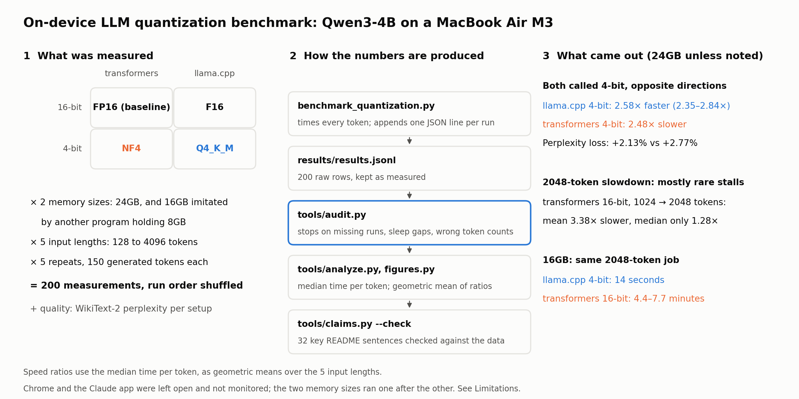

# On-Device LLM Quantization Benchmark — Qwen3-4B on a MacBook

[한국어](README.ko.md)

A personal study comparing the speed and language-modeling quality (WikiText-2 perplexity) of the language model Qwen3-4B on a MacBook Air (M3), run with **2 programs (transformers, llama.cpp) × 2 number precisions (16-bit, 4-bit)**. The raw data from 200 measurements and the analysis code are included.



> A fuller explanation of the results is in [docs/details.md](docs/details.md). Every table ([docs/full-report.ko.md](docs/full-report.ko.md)) and the history of measurement mistakes found and fixed ([docs/measurement-history.ko.md](docs/measurement-history.ko.md)) are in Korean.

## Takeaways

Speed ratios below compare the usual time per token (the median over the 150 generated tokens) and are geometric means over the 5 input lengths (128–4096 tokens), with the range by input length in brackets. The table under Results shows only 128 tokens, so dividing its numbers gives one value inside that range.

- **Two methods both called 4-bit went in opposite directions.** With 24GB of memory, llama.cpp 4-bit became 2.58× faster than its own 16-bit version (2.35–2.84×), while transformers 4-bit became 2.48× slower (0.36–0.46× the 16-bit speed). llama.cpp 4-bit also lost less quality (perplexity +2.13% vs +2.77%). The two 4-bit methods differ in detail, which is a suspected cause of part of the quality gap (see Limitations).
- **Most of the "3.3× faster" comes from 4-bit.** Going from transformers 16-bit to llama.cpp 4-bit is 3.28× faster (2.79–3.67×). Split into two steps starting from 16-bit, switching the program gives 1.27× and switching to 4-bit 2.58×. By input length these were 1.16–1.49× and 2.35–2.84×. Because the effect of 4-bit depends on the program, this split does not mean each factor has an independent contribution.
- **For transformers 16-bit, most of the sharp slowdown at 2048 input tokens came from rare stalls.** At 24GB, going from 1024 to 2048 tokens, the average speed dropped 3.38×, but the usual time per token (the median) only 1.28×, because a few of the 150 tokens stalled for seconds. Stalls are real waiting time, so the average (total waiting time) and the median (typical token delay) should be read together.
- **With 16GB of memory the gap grows to minutes.** The same job (2048-token input, 150 tokens generated) took llama.cpp 4-bit 14 seconds and transformers 16-bit 4.4–7.7 minutes, depending on the run. This transformers result varied the most between runs, so read it as a range.

## What was compared

|  | transformers | llama.cpp |
|---|---|---|
| **16-bit** | transformers 16-bit (FP16) — baseline | llama.cpp 16-bit (F16) |
| **4-bit** | transformers 4-bit (NF4) | llama.cpp 4-bit (Q4_K_M) |

- **transformers**: Hugging Face's Python library, the most common way to run models in research.
- **llama.cpp**: a lightweight C/C++ program for running models, widely used on laptops and PCs. Its model files use the GGUF format.
- **16-bit (FP16 / F16)**: each number stored in 16 bits, the original precision. **4-bit** stores most of the weights in 4 bits instead (quantization); transformers' format is NF4 and llama.cpp's is Q4_K_M. Neither is 4-bit throughout: Q4_K_M keeps some weights at 6 bits, and NF4 leaves the embedding and output layers at 16 bits.
- **Why llama.cpp 16-bit is included**: comparing only "transformers 16-bit" and "llama.cpp 4-bit" changes the program and the bit count at once, so you cannot tell which one made the difference. Adding llama.cpp 16-bit in between separates the two.
- **Why two memory sizes**: I only have one 24GB Mac, but wanted to see what happens on the common 16GB Mac. So another program held on to 8GB the whole time to reduce the memory left for the model. Same machine and same procedure; the only intended change is the extra 8GB taken up. Chrome and the Claude app were also left open on purpose, because a small model is often run alongside other programs; how much they were used was not monitored (see Limitations).

## Results


128 input tokens, 24GB of memory, median of 5 runs:

| Setup | Peak memory (GiB) | Speed (tokens/s) | Time to first token (s) | Perplexity (lower is better) |
|---|---|---|---|---|
| transformers 16-bit (FP16), baseline | 7.54 | 9.74 | 0.48 | 9.5413 |
| transformers 4-bit (NF4) | 2.88 | 3.48 | 0.67 | 9.8060 |
| llama.cpp 16-bit (F16) | –\* | 11.31 | 0.43 | 9.5417 |
| llama.cpp 4-bit (Q4_K_M) | –\* | 31.92 | 0.46 | 9.7446 |

\* llama.cpp has no PyTorch-style memory counter, so it was not measured.


Results by input length, the 16GB results and the diagnostic tests on why stalls happen are in [docs/details.md](docs/details.md).

## Setup

| Item | Details |
|---|---|
| Machine | MacBook Air (Apple M3, 8-core CPU · 10-core GPU) |
| Memory | 24GB unified memory (100GB/s bandwidth). The 16GB condition was imitated by having another program hold 8GB |
| Other programs running | Chrome and the Claude app, left open on purpose to resemble everyday use; their memory and CPU use were not recorded |
| Runtime | transformers: PyTorch MPS · llama.cpp: Metal build |
| Software | Python 3.12, torch 2.13.0, transformers 5.14.1, bitsandbytes 0.50.0, accelerate 1.14.0, llama-cpp-python 0.3.34, datasets 5.0.1, numpy 2.5.1, read afterwards from the virtual environment used for the measurements. Full list: [environment/requirements-measured.txt](environment/requirements-measured.txt) |
| Models | transformers: `Qwen/Qwen3-4B-Instruct-2507` · llama.cpp: F16 and Q4_K_M files from `unsloth/Qwen3-4B-Instruct-2507-GGUF` (revision and file hashes: [environment/model-files.txt](environment/model-files.txt)) |
| Measurement code | The working copy after the v6 commit ([`570caaa`](https://github.com/AhnJG/qwen3-4b-mac-quantization-benchmark/commit/570caaa)); the same instrumentation was committed the next day as [`f83d79e`](https://github.com/AhnJG/qwen3-4b-mac-quantization-benchmark/commit/f83d79e) |
| Measurements | 2026-08-09. 4 setups × 5 input lengths (128–4096 tokens) × 2 memory sizes × 5 repeats = 200. Each measurement generates 150 tokens; run order shuffled within each memory size |
| Quality | Perplexity on the full WikiText-2 test set (299,078 tokens). Answer accuracy and instruction following were not evaluated |

## Reproduce

Without a GPU, the speed tables and both figures can be rebuilt from the raw data in this repository, and the README's key numbers checked against it. It takes seconds and needs only Python 3 and matplotlib.

```bash
python tools/audit.py --repeats 5   # check the data (sleep gaps, missing runs, variance)
python tools/analyze.py             # speed tables
python tools/figures.py             # the two figures
python tools/claims.py --check      # key README numbers, checked sentence by sentence against the raw data
```

To measure again from scratch on an Apple Silicon Mac (the original run took about 1.3 hours at 24GB and 4.1 hours at 16GB), see [docs/reproduce.md](docs/reproduce.md).

## Files

```
benchmark_quantization.py   # the benchmark: context_sweep and perplexity stages
tools/
  audit.py                  # data check: sleep gaps, missing or short runs, token counts, variance
  analyze.py                # speed tables from results/results.jsonl
  figures.py                # the README figures (overview numbers come from claims.py)
  claims.py                 # every README number with its source; --check compares it with the docs
  cliff_probe.py            # diagnostic tests for the stalls
  output_agreement.py       # where the four setups' outputs start to differ
  ballast.py, pressure_probe.py   # holding memory to imitate a smaller Mac; mmap on/off test
results/                    # raw data (see results/README.md for every field)
  results.jsonl             # 200 audited measurements (current data)
  results_perplexity_v7.jsonl
  results_memory_pressure.jsonl
  probe_*.log               # saved outputs of the diagnostic tests
  archive/                  # data from older, superseded versions
docs/
  details.md, details.ko.md # README results explained in detail
  reproduce.md, reproduce.ko.md # how to measure again from scratch
  full-report.ko.md         # every table (Korean)
  measurement-history.ko.md # measurement mistakes found and fixed (Korean)
  estimator-bias-note.ko.md # why "pick the fastest run" was biased (Korean)
figures/
```

What each field in the raw data means is described in [results/README.md](results/README.md).

## Measurement record

The repository went through versions v1 to v8; the current data was measured in v7 (2026-08-09). Along the way six measurement mistakes were found and fixed, several of them by independent AI reviews; I decided which findings to accept and what to retract. The six were: input processing leaking into the generation speed, timing the GPU at the wrong moment, the computer sleeping mid-run, skew from repeating the same setup back-to-back, the average hiding stalls, and skew from picking the fastest of the repeats. How each was found and fixed is in [docs/measurement-history.ko.md](docs/measurement-history.ko.md) (Korean).

## Roles

- **Me**: setting the research question, adopting the experiment design proposed by AI (2×2 engine × precision), choosing the memory conditions (24GB, and 16GB imitated by holding 8GB; the memory-holding method itself was suggested in AI review), running the measurements on my own Mac with everyday apps left open on purpose, stopping and rolling back experiments that went in the wrong direction, and the final decisions on retracting weakly supported claims and on what to publish
- **AI coding tools (Claude, Codex)**: drafting the background research and plan, writing the measurement and analysis code, drafting documents, recomputing numbers from the raw data
- **AI review**: independent reviews looking for measurement defects and overstated wording. Several design changes (the 2×2 grid, the memory-holding and mmap controls) and the defects behind the retractions came from these reviews; I decided which findings to accept

## Limitations

- Measured on one Apple Silicon machine (MacBook Air M3) only. Whether results hold on a GPU with separate memory is untested.
- One model (Qwen3-4B), chosen because its 16-bit version must fit in 16GB. This separates causes; it is not advice on what to run on a 16GB Mac.
- Total time was measured, not individual GPU routines. Why transformers 4-bit is slow is an educated guess.
- 5 repeats, and 1–2 runs per setting for the diagnostic tests. Some comparisons cannot be decided with this many (marked in the details).
- The two "4-bit" setups do not store the same number of bits per weight: Q4_K_M keeps some weights at 6 bits, and NF4 keeps the embedding and output layers at 16 bits. The average bits per weight were not measured. This is a suspected cause of part of the quality difference (+2.13% vs +2.77%). It is less likely to explain the speed difference: transformers 4-bit was slower even than llama.cpp 16-bit, which stores far more bits (see details).
- On the llama.cpp side, each streamed chunk was counted as one token. A chunk can hold more than one token, so the unit is not guaranteed to match transformers' tokens exactly (30 llama.cpp measurements counted 149 instead of 150).
- The 16GB condition was imitated on a 24GB machine by taking up memory; it is not identical to a real 16GB Mac.
- I did not check whether the llama.cpp 4-bit file was made with calibration data (an importance matrix); if so, that could favour it in the perplexity comparison.
- Chrome and the Claude app were left open on purpose during the measurements, but how much they were used and how much memory they took was not monitored. Swap (memory pushed out to disk) was already 4.46GB (24GB condition) and 5.74GB (16GB condition) right after the first measurement, so the memory actually available to the model was probably less than 24GB and 16GB. The two conditions are therefore "the 24GB machine as it was" and "the same with another 8GB taken up", not exact amounts of usable memory.
- The four setups were measured in shuffled order within the same session, so the comparisons between them are fairly safe. The two memory sizes, however, were run one after the other (24GB 15:30–16:47, 16GB 16:59–21:05), so the difference between them mixes the extra 8GB with any change in the other programs' load. The size of the stalls and the minutes-long 16GB results may have been affected.
- Some records were not kept at measurement time: the macOS version, the package list (the versions above were read from the measurement environment afterwards), the exact code version, the transformers model revision, and the WikiText-2 dataset revision.

## License

Code: MIT ([LICENSE](LICENSE)). Data (`results/`), documents (README, `docs/`) and figures (`figures/`): [CC BY 4.0](https://creativecommons.org/licenses/by/4.0/) — free to use with attribution. Code examples inside the documents are MIT.
